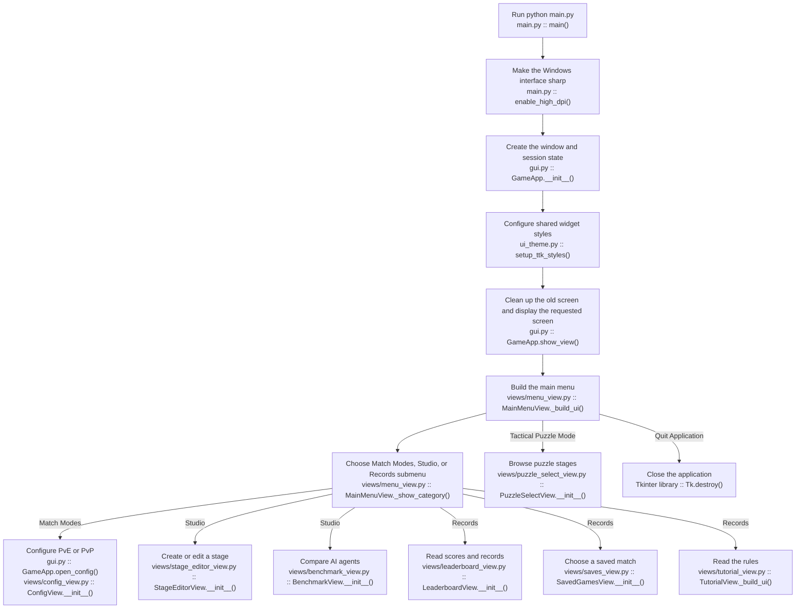
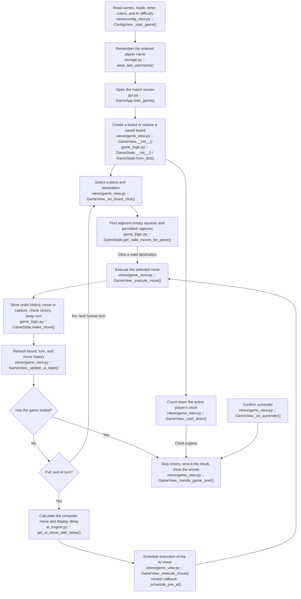
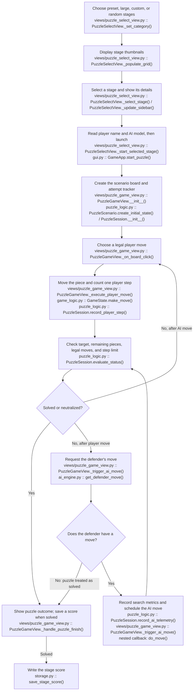
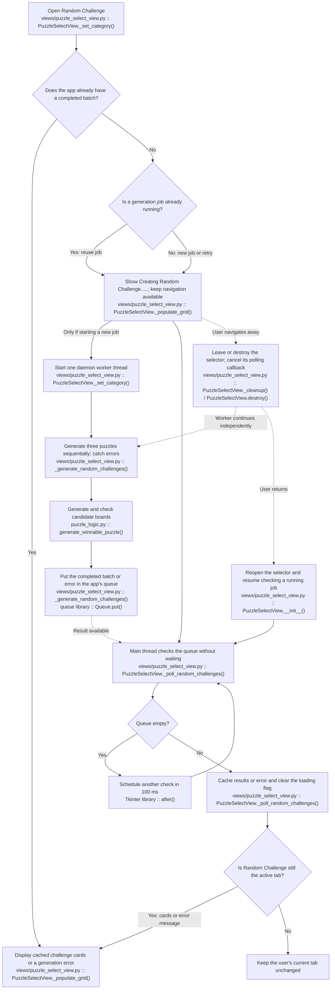
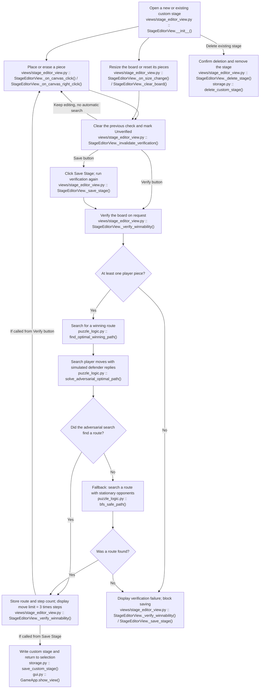
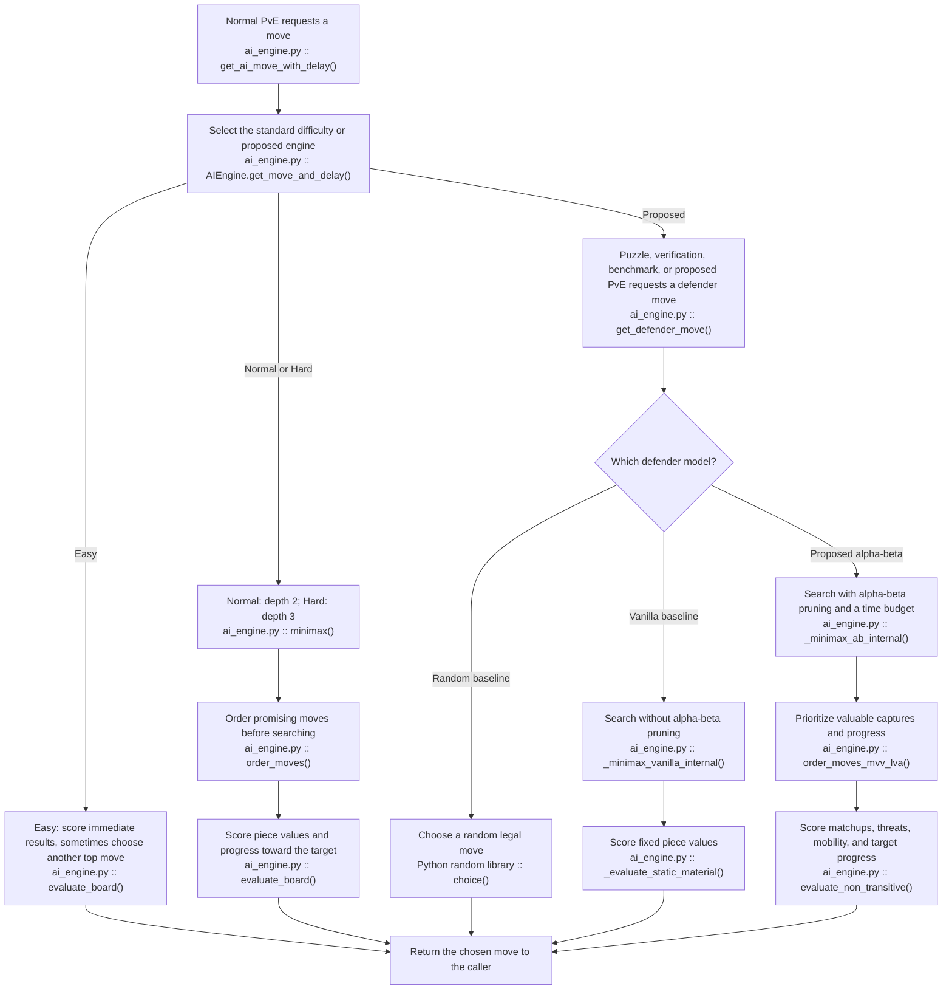
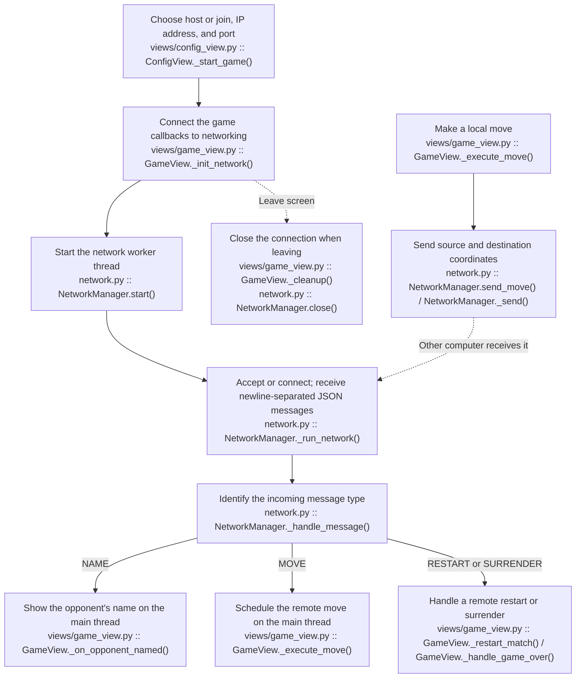
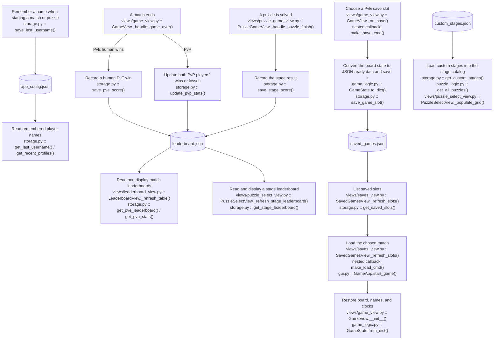
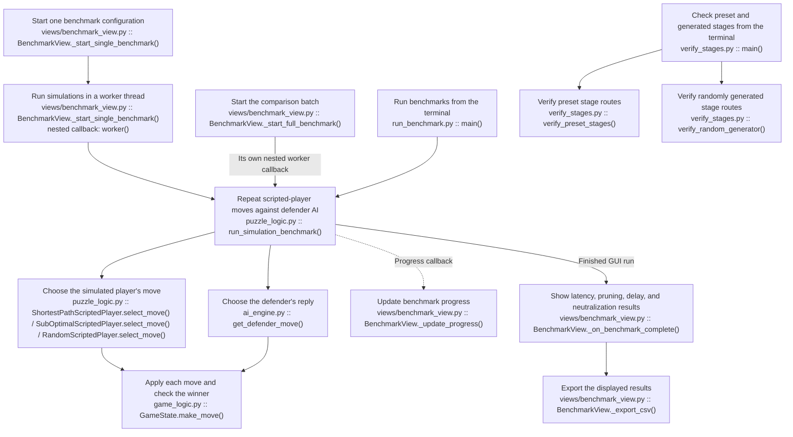

# Chess-Sut: application flow and code map

Read diagram 1 first, then follow the feature you want to study.
Each operation shows **plain-English behavior**, then **actual filename :: actual function**.
Decision diamonds describe conditions inside those functions. Arrows show execution,
button events, or data flow; this is a learning map, not a strict function-call graph.
Nested callbacks are marked explicitly. JSON boxes are stored data, not Python functions.

## 1. Starting the app and choosing a screen

`main()` also calls `app.mainloop()`, inherited from Tkinter. That event loop
handles clicks, repainting, timers, and scheduled callbacks for every screen.
Menu actions go through `GameApp.show_view()` or a small helper such as
`open_config()`. Submenu changes rebuild the menu itself.

## 2. Normal matches: player versus AI or player versus player

The UI checks whether a clicked destination is legal before executing it.
`GameState.make_move()` applies the move; it is not a complete standalone
validator of movement distance. In local PvP, the two humans share this same
click-and-move flow. Network PvP adds diagram 7.

## 3. Puzzle selection and puzzle gameplay

Only player moves count toward the puzzle limit. `PuzzleScenario.__init__()`
sets `s_max = 3 * s_optimal`. The AI's reply does not consume a player step.

## 4. Random Challenge: background work and a responsive interface

The queue and cached batch belong to `GameApp`, initialized in
`gui.py :: GameApp.__init__()`. They survive replacing the selection screen.
The worker never changes widgets. Polling belongs to the screen and stops when
that screen is destroyed. Returning after a failure starts a retry when the
user selects Random Challenge again.

## 5. Stage editor and puzzle verification

Editing no longer launches the solver automatically. Manual verification and
Save Stage still calculate on the UI thread. The search is bounded and has a
static fallback, so the displayed step count is not a proof of the shortest
route against perfect defense.

## 6. How the AI chooses a move

This diagram summarizes recursive search; it does not show every recursive call.
Both move entry points also check for an immediately winning move before their
normal difficulty/model branches. `get_defender_move()` additionally returns
an evaluation score and `SearchTelemetry` metrics.

## 7. Network multiplayer

Network callbacks use `self.after(0, ...)` to schedule UI work.
Remote moves pass `from_network=True` so they are not sent back to the peer.

## 8. Player profiles, scores, and saved matches

All four JSON files are local runtime data. `storage._load_json()` and
`storage._save_json()` handle the common file operations. Guest mode is removed;
old guest names remain ordinary names. The recent-profile list retains up to
10 names. Custom stages are loaded through `puzzle_logic.get_all_puzzles()`;
they are not leaderboard records.

## 9. Benchmark lab and standalone developer tools

Unlike the GUI benchmark, `run_benchmark.py` prints results to the terminal.
The verification script calls the same puzzle-search functions described in
diagram 5. Tests are separate checks under `tests/`, not part of normal startup.

## Important distinctions when explaining this app

- **Screen:** a Tkinter frame, usually one class in `views/`.
- **Controller:** `GameApp` chooses which screen exists at a given time.
- **State:** `GameState` holds the board, turn, history, and winner.
- **AI:** search code in `ai_engine.py` chooses moves; it does not draw the board.
- **Worker thread:** explicitly created by `threading.Thread(...)` for random
  generation, networking, and GUI benchmarks.
- **Scheduled callback:** `after(...)` runs later on the UI thread. Scheduling
  an expensive calculation this way does not make it background work.
- **Queue:** random-generation results travel from the worker to the UI through
  the application-owned `random_challenge_queue`.
- **Current limitation:** normal-match AI, puzzle defender search, and manual
  stage verification still calculate on the UI thread.
